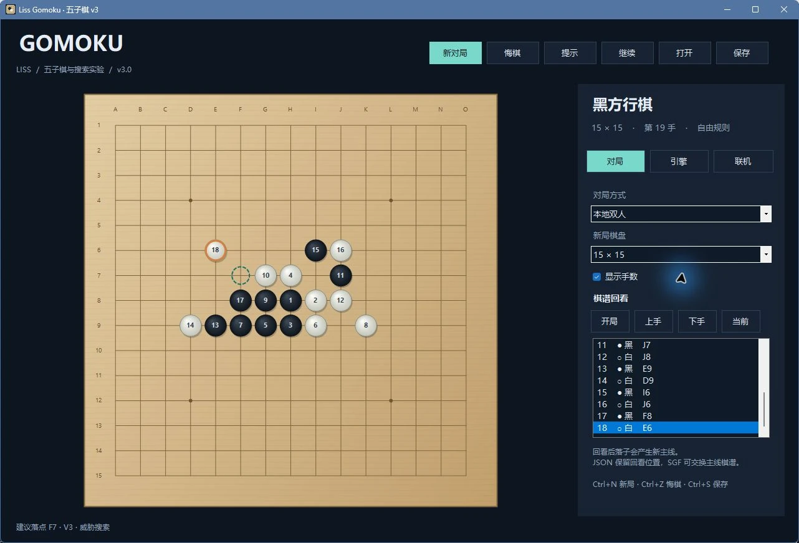

# Liss Gomoku · 五子棋 V3.1

一个保留早期搜索算法、重新整理交互与工程实现的 Windows 五子棋程序。支持人机、本地双人、引擎自对弈、Photon 在线双人，以及棋谱保存和回看。3.1 新增双方独立搜索设置与思考统计。

[作品介绍](https://heroliss.github.io/liss-works/projects/gomoku/) · [下载最新 Windows 版本](https://github.com/heroliss/gomoku/releases/latest) · [更新记录](docs/CHANGELOG.md)



V3 根据找回的 **v2.3 工程源码**重新开发；旧备份中虽然还有 **v2.5 EXE**，本次没有声称还原其缺失源码。原始备份保留在本地，不混入公开仓库。

## 体验

下载完整 Windows x64 ZIP，解压到可写目录，运行 `Liss.Gomoku.exe`。发布包自带 .NET 10 Desktop Runtime，无需另外安装运行时。首次启动可新建对局；关闭后自动保存，重新打开会恢复并暂停，点击继续即可。

- **规则**：默认 15 路，可新建 19 路。黑方先行，连续五子或更长获胜；无禁手、交换或让子规则。
- **对局**：我执黑、我执白、本地双人、引擎自对弈；支持提示、暂停、悔棋及逐手回看。
- **联机**：Photon Asia 大厅，房主执黑。双方使用 V3 的独立房间协议，不能加入旧版本房间；悔棋和重开需要对方同意。服务、网络和原应用账户配额会影响可用性。
- **界面**：木纹棋盘、棋子明暗与落点提示，支持显示手数和键盘落子。

## 11 种引擎

旧算法保留独立代码路径，并修复边界、缓存及计分问题，可对比节点、完成深度、耗时和缓存命中。所有引擎都有一步成五/紧急防守检查以及限时退出。

| 引擎 | 思路 |
| --- | --- |
| V3 威胁搜索 | 迭代加深、威胁排序、PVS、Zobrist 置换表、杀手走法与历史启发；默认推荐 |
| 负极大值 | 保留无剪枝的 Negamax，便于对照搜索树开销 |
| Alpha–Beta | 使用上下界剪枝，保留 fail-hard 结构 |
| Fail-soft | 返回实际分数或边界，改进剪枝结果表达 |
| 渴望搜索 | 先浅搜预测，再用窄窗搜索；失败时重搜 |
| 历史启发 | 根据历史剪枝收益排序走法 |
| 置换表 | 缓存相同局面，避免重复计算 |
| PVS | 首走法全窗口，其余先用空窗口探测 |
| PVS + 历史启发 | 将主变例搜索与历史排序结合 |
| PVS + HH + TT | 进一步缓存局面结果 |
| 五元组单层 | 将五格窗口的攻防价值累加到候选落点；不使用搜索深度或外部估值选项 |

可选择棋型或五元组估值。深度显示的是**完整完成的搜索层数**，时间用完保留最近完整结果。新引擎是裁剪候选的选择性搜索，不是完全求解器，不保证所有战术或某个棋力等级。

## 双方设置与思考统计

在“引擎”页分别设置黑方、白方的引擎、深度 **1–8**、每步预算 **250–10,000 ms** 和评估函数；修改一方不影响另一方。单层五元组不使用深度和外部评估选项，但保留所选值供切回其他引擎使用。设置独立于棋谱保存在 `engine-preferences.json`，下次启动恢复。

“统计”页按黑白分别显示最近、累计和平均耗时、决策次数、累计节点与命中，以及最近完成深度。只统计**当前棋谱位置之前、已实际落子的 AI 决策**：提示、取消、人工和联机落子不计；回看、悔棋与重做跟随当前前缀汇总，新局或读档重置测量。统计不写入棋谱。

搜索通过 `Task.Run` 在后台工作线程执行，内部搜索仍为单线程。耗时是墙钟时间，不是 CPU 利用率，不据此声称并行搜索或硬件性能收益。

## 操作与棋谱

| 操作 | 快捷键 |
| --- | --- |
| 新对局 / 悔棋 | `Ctrl+N` / `Ctrl+Z` |
| 保存 / 打开 | `Ctrl+S` / `Ctrl+O` |
| 暂停当前搜索 | `Esc` |
| 移动棋盘焦点 / 落子 | 方向键 / `Enter` 或空格 |

JSON 保存完整棋谱、回看位置及模式；SGF 保存完整主线，可读取旧程序常见的 `(;;B[hh];W[ii];)`。回看后落子会建立新主线。只接受合法交替落子，单个文件上限 1 MiB；SGF 分支、设子、停着、白先和多棋谱会明确报错。

自动保存与错误日志：`%LOCALAPPDATA%\Liss\Gomoku3\`。可用 `LISS_GOMOKU_DATA_DIR` 环境变量指定独立数据目录。保存采用同目录临时文件与替换，失败尽量保留上一次有效文件。

**不读取旧版 `.wzq` 等二进制序列化文件**，不启用不安全的 BinaryFormatter。旧 QFS 也不属于本版支持格式；请先通过原工具转换为 SGF。程序没有内置聊天、观战、断线棋局重连或云存档。

## 从源码构建

Windows + PowerShell 7 + [.NET 10 SDK](https://dotnet.microsoft.com/zh-cn/download/dotnet/10.0)。公开源码不包含旧备份和 Photon SDK DLL；获取兼容版本及合法使用说明见 [构建说明](docs/BUILDING.md) 与 [Photon 声明](licenses/PHOTON-NOTICE.md)。

```powershell
# 首次：检查环境，将已合法取得的兼容 SDK 放入忽略目录
.\scripts\bootstrap.ps1 -PhotonSdkDirectory 'C:\SDKs\Photon405'

dotnet build src/Gomoku.App/Gomoku.App.csproj -c Release
dotnet run --project src/Gomoku.App -c Release

# 或直接指定 SDK 目录，不复制文件
dotnet build src/Gomoku.App/Gomoku.App.csproj -c Release -p:PhotonSdkDirectory='C:\SDKs\Photon405'

# 执行测试，再生成完整自包含 ZIP
.\scripts\publish.ps1
```

```powershell
dotnet run --project tests/Gomoku.Core.Tests -c Release
dotnet run --project tests/Gomoku.Analysis.Tests -c Release
dotnet run --project tests/Gomoku.Storage.Tests -c Release
dotnet run --project tests/Gomoku.Preferences.Tests -c Release
dotnet run --project tests/Gomoku.Networking.Tests -c Release
```

以下参数会进入真实可操作的固定中盘，适合复现实验与截图；提示仍由选定引擎实际计算：

```powershell
.\Liss.Gomoku.exe --showcase --hint --page engines
.\Liss.Gomoku.exe --showcase --engine legacy-negamax --depth 8 --budget 10000 --autoplay --page engines

# 空棋盘开始，双方使用独立设置，真实自对弈 12 手后暂停并查看统计
.\Liss.Gomoku.exe --showcase --empty-showcase --autoplay --autoplay-plies 12 --page stats --black-engine threat-search --black-depth 3 --black-budget 1000 --black-evaluation patterns --white-engine legacy-alpha-beta --white-depth 2 --white-budget 750 --white-evaluation quintuple
```

`--black-*` / `--white-*` 分别覆盖该方的 `engine`、`depth`、`budget`、`evaluation`；仍支持同时设置两方的 `--engine`、`--depth`、`--budget`、`--evaluation`，同一字段以单方参数优先。评估值为 `patterns` 或 `quintuple`。`--page stats` 打开统计页；`--empty-showcase` 配合 `--showcase` 使用空棋盘，`--autoplay-plies N` 限制本次继续自动落子的手数。

Core、Analysis、Storage、Preferences 测试无需 Photon 或 Windows UI；Networking 测试需要兼容 SDK，其中真实双客户端联机验收须另行执行。测试报告与打包输出放在忽略的 `artifacts/` 中；打包不等于实际 GUI/网络验收。

Photon 为 Exit Games 的专有依赖；完整游戏分发随附 Photon 与 .NET Runtime/WinForms 的许可及第三方声明，不提供独立 SDK 镜像。这些依赖声明不为本仓库额外授予开源许可。

